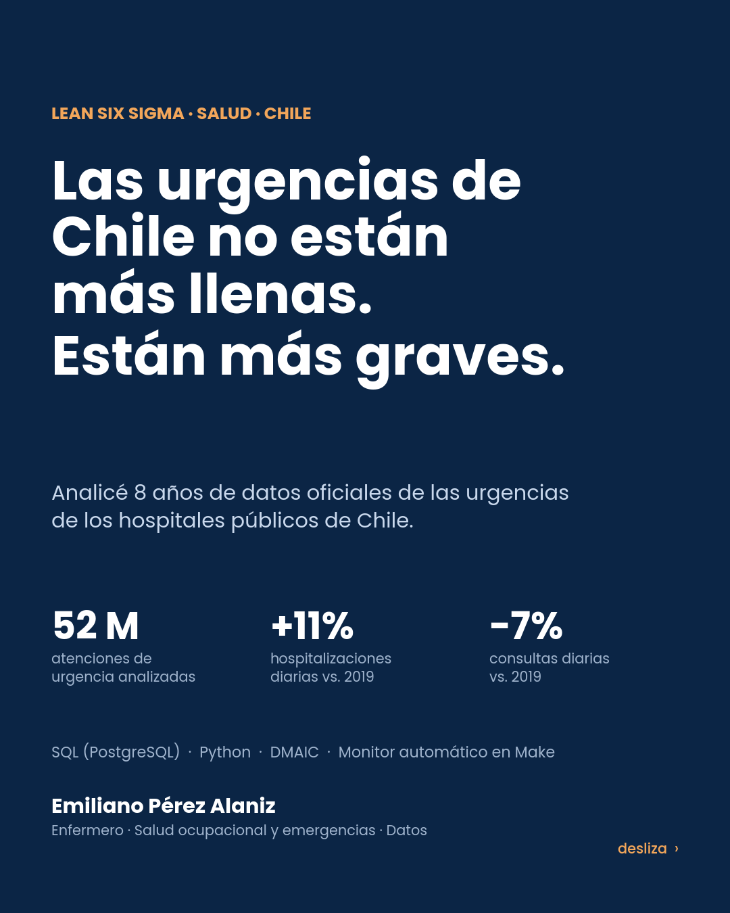

# Urgencias de Chile: menos consultas, más internaciones

**Análisis Lean Six Sigma de las urgencias de los hospitales públicos de Chile, 2019 a 2026, con datos oficiales del Ministerio de Salud**

Monitor automático en Make + tablero ejecutivo interactivo

Autor: Emiliano Pérez Alaniz · Enfermero con experiencia en emergencias y salud ocupacional · SQL (PostgreSQL) · Python



## La pregunta

¿Qué está presionando hoy a la urgencia hospitalaria pública de Chile, y qué se puede hacer para que atienda más rápido? Lo encaré con DMAIC (Definir, Medir, Analizar, Mejorar, Controlar) sobre los registros diarios de atención de urgencia que publica el DEIS.

## Qué encontré

| Indicador (hospitales públicos, enero a septiembre) | 2019 | 2026 | Cambio |
|---|---|---|---|
| Consultas de urgencia por día | 20.882 | 19.501 | −6,6% |
| Hospitalizaciones desde urgencia por día | 1.576 | 1.755 | +11,4% |
| Tasa de hospitalización | 7,5% | 9,0% | +1,5 p.p. |
| Cirugías de urgencia (ene-sep) | 57.647 | 65.524 | +13,7% |
| Consultas de mayores de 65 (% del total) | 15,1% | 18,5% | +14,5% en cantidad |
| Consultas de menores de 5 años | 1.031.964 | 650.739 | −36,9% |

1. **Llegan menos personas, pero más graves.** Las consultas diarias bajaron 6,6% respecto de 2019 y las hospitalizaciones subieron 11,4%. Hoy 1 de cada 11 consultas termina en internación.
2. **Cambió el paciente.** Hay 37% menos consultas de menores de 5 años y 15% más de mayores de 65. Los mayores ya son el 37% de las hospitalizaciones que salen de la urgencia.
3. **La edad no lo explica todo.** Si en 2026 se aplicaran las tasas de internación de 2019 a la mezcla de edades actual, la tasa sería 8,0% y no 9,0%. La edad explica el 31% de la suba; el resto viene de tasas más altas dentro de cada grupo (de 15 a 64 años pasó de 6,9% a 8,2%). Una hipótesis posible, no comprobada con estos datos, es que los casos leves se están atendiendo en los SAR, que duplicaron su volumen entre 2019 y 2025 (de 2,3 a 4,6 millones de atenciones).
4. **La demanda tiene un patrón previsible.** El lunes llega un 14% más de gente que el promedio y el fin de semana un 14% menos.
5. **El invierno llena la sala de espera, no las camas.** Las consultas semanales varían 7,6% (picos respiratorios); las hospitalizaciones, solo 4,1%. La presión sobre las camas es estructural.
6. **Carta de control I-MR de hospitalizaciones semanales.** 11 de 143 semanas quedan fuera de límites (en consultas son 38). Las semanas bajas coinciden con fiestas de fin de año, verano y Fiestas Patrias. Pero 5 de las 6 semanas que superan el límite superior son de 2026 y seguidas, del 16 de agosto al 13 de septiembre: es un cambio de nivel, no variación común.
7. **La tasa de internación depende mucho de la región.** En 2025 va de 4,8% (Aysén) a 12,0% (Maule). Puede reflejar complejidad, disponibilidad de camas o forma de registro; hay que auditarlo antes de comparar desempeño entre servicios.

## Monitor automático con Make

El análisis no queda congelado. Un escenario de Make (`make/monitor_urgencias_chile.blueprint.json`) corre todos los lunes a las 9:00:

```
HTTP HEAD al archivo 2026 del DEIS → Data store (última versión vista) → Google Sheets (registro de cada chequeo)
   → [filtro: cambió la fecha de modificación] → Data store (guarda la nueva versión) → Gmail (aviso con el resumen)
```

Make no descarga ni procesa el archivo de 1,5 GB: solo pide el encabezado (fecha y tamaño), deja trazabilidad y avisa. Cuando llega el aviso se corre el pipeline de SQL y Python, que regenera KPIs, carta de control, tablero y carrusel. Probado el 05/10/2026: la primera corrida detectó la versión nueva y avisó; la segunda registró el chequeo sin cambios y no mandó mail.

## Tablero ejecutivo

`docs/tablero.html` es un tablero interactivo de una sola página (abrir en el navegador): KPIs, carta I-MR con selector internaciones/consultas, línea base anual, tasa por edad, patrón semanal, ranking regional, Pareto de hospitales, circuito de automatización y acciones DMAIC. Se genera con `python analisis/tablero_datos.py`.

## Qué haría con esto (Mejorar y Controlar)

- **Turnos según la curva semanal:** reforzar lunes y martes con la dotación que el fin de semana tiene menos demanda.
- **Gestión de altas:** si el cuello de botella son las camas, la espera en urgencia se resuelve arriba, con altas tempranas y planificación de egresos.
- **Ruta para mayores de 65:** evaluación geriátrica temprana desde el triage.
- **Publicar la espera de cama:** el registro DAU tiene los campos "pacientes en espera de hospitalización" y "esperan menos de 12 horas", pero se publican en cero. Sin ese dato no se puede controlar el tiempo de espera, que es lo que vive el paciente.

## Datos y validación

- **Fuente:** DEIS, Ministerio de Salud de Chile, conjunto "Atenciones de urgencia de la red pública de salud" (registro DAU). Archivos anuales 2019 a 2026; el de 2026 fue actualizado el 5 de octubre de 2026.
- **Universo:** 186 establecimientos de tipo Hospital, 500.054 registros hospital-día, 52.183.940 atenciones y 4.493.350 hospitalizaciones.
- **Validación cruzada:** el total de atenciones de enero a septiembre de 2019 sale idéntico (5.700.840) en dos extracciones independientes (por causa y por edad), y lo mismo pasa con las hospitalizaciones de 2026.
- **Limpieza:** los ID de establecimiento vienen con espacios al final en algunos años y el nombre de la columna de causa cambia (IdCausa / Idcausa). El archivo de 2020 publicado en "SistemaAtencionesUrgencia" es un Excel; se usó la versión CSV de "DatosAbiertos".
- **Rezago de carga:** los últimos días publicados tienen menos hospitales informando, por eso las series semanales cortan el 27/09/2026.

## Estructura

```
data/raw/urg_chile_hospital_dia.csv     hechos hospital-día (2019-01-01 a 2026-10-04)
data/raw/hospitales.csv                 dimensión hospitales (región, servicio de salud, comuna)
data/raw/hospital_edad_ene_sep.csv      atenciones y hospitalizaciones por edad (ene-sep)
data/raw/red_urgencia_anual_tipo.csv    atenciones de toda la red por tipo de establecimiento
sql/01_schema.sql                       modelo de datos (esquema urg)
sql/00_carga.sql                        carga y limpieza
sql/02_kpis.sql                         vistas: línea base, día de semana, Pareto, carta I-MR, edad
etl/extraccion_navegador.js             extracción desde los zips del DEIS
analisis/carrusel.py                    cálculo de KPIs (analisis/kpis.json) y carrusel de 12 láminas
analisis/tablero_datos.py               series del tablero (analisis/tablero.json) y docs/tablero.html
make/monitor_urgencias_chile.blueprint.json   escenario de Make (importable en Make)
docs/                                   tablero, láminas, carrusel en PDF y post
```

## Cómo reproducir

```bash
psql -f sql/01_schema.sql
psql -f sql/00_carga.sql
psql -f sql/02_kpis.sql
pip install pandas matplotlib img2pdf
python analisis/carrusel.py
python analisis/tablero_datos.py
```

## Limitaciones

- Datos agregados por hospital y día: no hay triage, tiempos de espera ni datos por paciente.
- Los campos de espera de hospitalización existen en el registro pero se publican vacíos.
- 2020 y 2021 están distorsionados por la pandemia.
- La causa del aumento de la tasa de internación, más allá del envejecimiento, es una hipótesis.

## Fuentes

- DEIS, Ministerio de Salud de Chile: [Atenciones de urgencia de la red pública de salud](https://datos.gob.cl/dataset/atenciones-de-urgencia), archivos en [repositoriodeis.minsal.cl](https://repositoriodeis.minsal.cl/).
